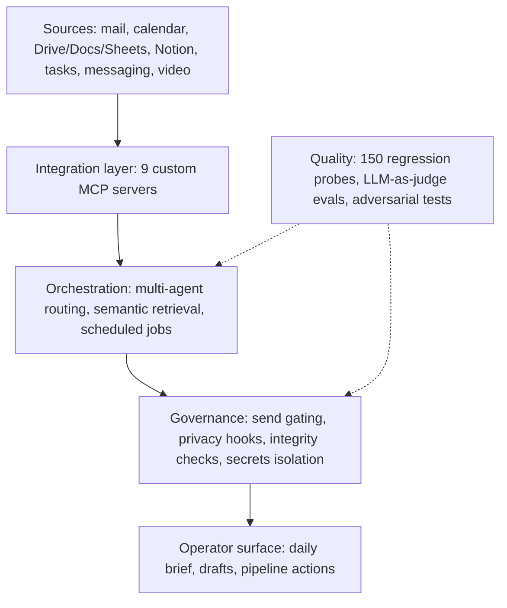

# Maurice James

**AI builder and media executive.** 25 years making film and television (NBCUniversal, BuzzFeed, LA Times Studios, WebMD/Medscape). Columbia CS, concentration in AI. Based in Los Angeles.

I build the AI systems I used to buy.

## MojoOS

An agentic AI operating system I designed and built, in daily use since April 2026. Architect and sole engineer, pair-programming with Claude Code.

**Case study:** [mauricejames.ai/work/mojoos](https://mauricejames.ai/work/mojoos/)

```
128K   lines of Python (tests not counted)
409    Python programs
9      MCP servers written from scratch (7 Python, 2 Node)
150    regression probes, run twice a day
1,110  commits since April 23, 2026
```
<sub>Counted October 19, 2026.</sub>



**What I care about:**
- **What it must never do matters more than what it can do.** Email sent through my own mail server can only become a draft. That rule lives in the server, not in a prompt.
- **The scariest failure is the silent one.** An interface that keeps returning plausible, stale answers gets a standing check that reads a known-recent record and fails loudly.
- **Confirmed failures become permanent tests.** If code can check for a mistake, the mistake gets a probe, so it can't come back unnoticed.

## Why the code is private

It runs my life and holds my data. I'm happy to walk you through the architecture and the evaluation layer in 20 minutes. Reach me through [mauricejames.ai](https://mauricejames.ai).

## Elsewhere

- Site: [mauricejames.ai](https://mauricejames.ai)
- LinkedIn: [linkedin.com/in/mauricepjames](https://www.linkedin.com/in/mauricepjames/)
- How to Train Your AI on X: [@how2trainyourai](https://x.com/how2trainyourai)
